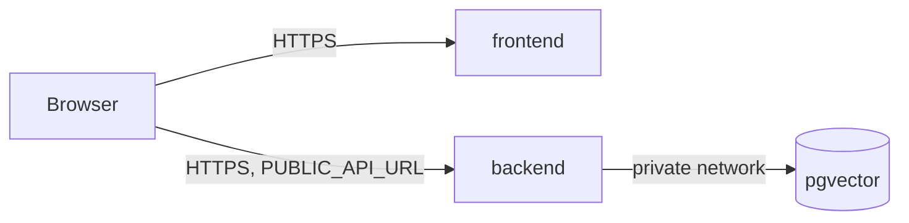

# Railway overview

Verified 2026-11-10 with Railway CLI 5.35.1.

## Project layout

Project `music-railway-infraestructure`, one environment `production`, region `us-east4`. Every service runs **1 replica** in that one region.

| Service | Source | Role | Sleeps when idle |
|---|---|---|---|
| `frontend` | Source-less, uploaded by `railway up ./frontend --path-as-root` | Static Astro site (`serve dist` on `$PORT`) | Yes |
| `backend` | Source-less, uploaded by `railway up ./backend --path-as-root` | FastAPI on `$PORT`; `AGENTOS_ENABLED` unset, so AgentOS is not mounted | Yes |
| `pgvector` | Image `pgvector/pgvector:pg18` (template `3jJFCA`) + volume | App database, private network only | **No**, see [why](serverless-sleep.md#pgvector-stays-awake) |
| `terraform-states` | Image `ghcr.io/railwayapp-templates/postgres-ssl:18` + volume | Terraform state backend (Terraform not scaffolded yet) | Yes |

The backend reaches the database through `DATABASE_URL=${{pgvector.DATABASE_URL_PRIVATE}}` (private network, no egress fees).



## Where settings live

A Railway deployment combines settings from three places. Which one wins matters when you change anything:

| Source | Holds | How to change |
|---|---|---|
| Service instance settings | Sleep, replicas, region, limits, health check, restart policy | Dashboard, or `railway api` with `serviceInstanceUpdate` / `serviceInstanceLimitsUpdate`, or `railway scale` |
| Config-as-code file (`frontend/railway.json`, `backend/railway.json`) | Build settings, plus any `deploy.*` keys it sets | Edit the file, then deploy. **Currently not applied**, see [known issues](known-issues.md#railwayjson-deploy-settings-are-not-applied) |
| Deployment snapshot | A copy of the settings taken when the deployment was created | Only replaced by creating a new deployment, see [applying a change](serverless-sleep.md#commands) |

Railway is replacing `railway.json` with a TypeScript config (`railway config init|pull|plan|apply`, file `.railway/railway.ts`). `specs/002-railway-deploy/plan.md` records 2026-12-01 as the deprecation date.

## Looking up IDs

API calls need service and environment IDs. Resolve them by name; never commit them:

```bash
P=$(railway list --json | jq -r '.[] | select(.name=="music-railway-infraestructure") | .id')
railway status -p "$P" -e production --json > /tmp/rw.json
E=$(jq -r '.environments.edges[] | select(.node.name=="production") | .node.id' /tmp/rw.json)
sid() { jq -r --arg n "$1" '.environments.edges[] | select(.node.name=="production")
  | .node.serviceInstances.edges[].node | select(.serviceName==$n) | .serviceId' /tmp/rw.json; }

sid backend   # → service ID
```

Public domains (read-only, from the status JSON saved above; `railway domain` provisions domains and must not be used for lookup): `jq -r --arg n backend '.environments.edges[] | select(.node.name=="production") | .node.serviceInstances.edges[].node | select(.serviceName==$n) | .domains.serviceDomains[]?.domain' /tmp/rw.json`.

The other docs in this folder assume `P`, `E` and `sid` are defined.

## Inspecting the live settings

The settings a deployment actually runs with are in its snapshot (`serviceManifest.deploy`):

```bash
railway status -p "$P" -e production --json | jq -r '.environments.edges[0].node.serviceInstances.edges[].node
  | [.serviceName, .activeDeployments[0].status,
     (.activeDeployments[0].meta.serviceManifest.deploy
      | "sleep=\(.sleepApplication) replicas=\(.numReplicas) health=\(.healthcheckPath) retries=\(.restartPolicyMaxRetries)")]
  | @tsv'
```

The instance setting (what the *next* deployment gets) is separate:

```bash
railway api 'query($s:String!,$e:String!){serviceInstance(serviceId:$s,environmentId:$e){sleepApplication numReplicas}}' \
  --raw-var s="$(sid backend)" --raw-var e="$E" --compact
```

If these two disagree, the change was saved but not deployed yet.
